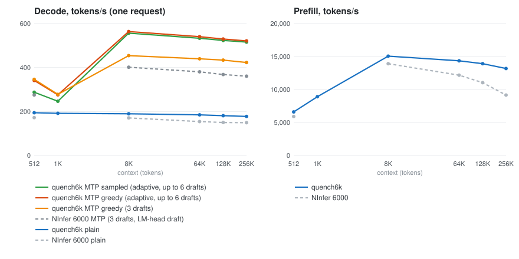

# Benchmark

One request on an RTX PRO 6000 Blackwell at 600 W, compared with NInfer 6000 measured on the same
machine. Tokens per second. Dotted lines with open markers are the FP8 KV cache (`--kv fp8`, the
serving configuration), solid lines BF16.

**Greedy and sampled.** Greedy decoding takes the most likely token; normal requests sample at
temperature 1.0 (top_p 0.95, top_k 20). Sampled text is less predictable, so the MTP head's drafts are
accepted less often and each round commits fewer tokens.

<!-- bench:begin -->
BF16 KV cache (the NInfer 6000 baseline's configuration):

| Context | Decode | NInfer decode | MTP greedy, 3 drafts | NInfer MTP, 3 drafts | MTP greedy, adaptive ≤ 6 | MTP sampled, adaptive ≤ 6 | Prefill | NInfer prefill |
|---:|---:|---:|---:|---:|---:|---:|---:|---:|
| 512 | 194.1 | 172.0 | 346.1 | 274.8 | 340.9 | 287.5 | 6,595 | 5,905 |
| 1K | 191.5 | – | 277.8 | – | 275.5 | 246.5 | 8,905 | – |
| 8K | 189.5 | 170.6 | 454.0 | 401.3 | 563.7 | 556.4 | 15,058 | 13,908 |
| 64K | 184.5 | 153.9 | 439.6 | 380.3 | 540.2 | 533.1 | 14,352 | 12,171 |
| 128K | 180.7 | 149.8 | 433.7 | 368.0 | 529.6 | 523.1 | 13,909 | 11,032 |
| 256K | 177.3 | 149.0 | 422.6 | 360.6 | 521.1 | 515.5 | 13,182 | 9,154 |

FP8 KV cache (`--kv fp8`, the serving configuration):

| Context | Decode | MTP greedy, adaptive ≤ 6 | MTP sampled, adaptive ≤ 6 | Prefill |
|---:|---:|---:|---:|---:|
| 512 | 197.9 | 301.9 | 322.0 | 6,700 |
| 1K | 196.8 | 329.2 | 284.9 | 8,973 |
| 8K | 194.3 | 581.8 | 573.2 | 15,099 |
| 64K | 189.4 | 557.9 | 549.8 | 14,283 |
| 128K | 182.5 | 542.0 | 536.0 | 13,777 |
| 256K | 179.9 | 537.4 | 529.7 | 12,373 |
<!-- bench:end -->

Real prompts through the server (`--kv fp8`, sampled at temperature 0.6 and 1.0 with top_p 0.95 and
top_k 20, 600-token answers to a coding, an explanation and a story prompt): 223–338 tokens/s,
282 overall. Code is fastest, prose slowest.

Two concurrent requests (`batch-check`, greedy, the code and multiturn fixtures, 192 tokens each):
418 tokens/s together with speculative pair rounds (3.4 tokens per request and round), 276 with
batched plain steps.

## Method

- `quench6k bench`: the prompt is the first N tokens of `bench/context.ids` (the 256K row uses
  260,000 tokens, the corpus length); decode generates 256 tokens after it, greedy. Plain decode
  reports the median of three runs of 85 tokens.
- Every run first checks 64 greedy tokens of the code fixture against the reference. Each context is
  measured after an unreported run at the same context, so the embedding rows of the generated
  tokens are in the page cache, as in a running server.
- Sampled rows use the server's default parameters and report the mean over four seeds of 256
  tokens each. They are checked through the same sampling kernels with top_k 1 against the
  reference, and print the start of their output.
- Each measurement records the GPU's temperature, SM clock, power and clock-event reasons (NVML) and
  warns when the GPU slowed down. Prefill depends on the SM clock, which falls as the GPU heats
  (2.8 GHz cool, about 2.25 GHz at 90 °C); decode is bound by memory bandwidth and barely changes.
- MTP rows run with the MTP head's cache filled during prefill, as the server does; their prefill
  includes that work.
- From 8K on, the corpus repeats its text, so MTP drafts are almost always accepted (about 7 tokens
  per round), greedy or sampled. At 512 and 1K it does not repeat yet, and rounds commit 2–3 tokens,
  as on real prompts.
- Data: `bench/results.jsonl` and `bench/ninfer-6000.jsonl`. The tables and the chart are generated
  from them with `crates/benchplot` ([DEVELOPMENT.md](DEVELOPMENT.md#benchmarks)).
