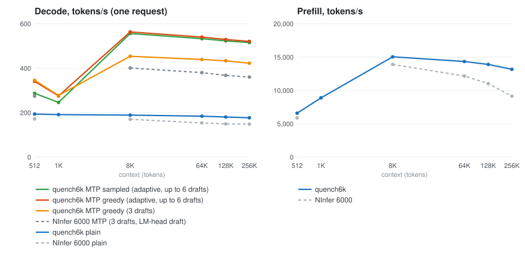
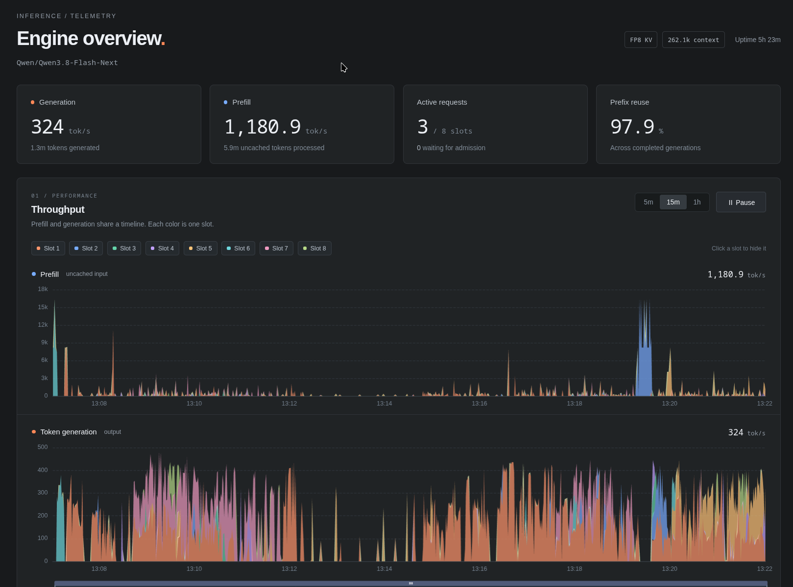

# quench6k

**Large mixture-of-experts models on a single NVIDIA RTX PRO 6000 Blackwell (96 GB), at full context, for
eight conversations at once.**

quench6k is an inference server written for one card: the RTX PRO 6000 Blackwell and its 96 GB. Every
kernel is hand-written CUDA for `sm_120a` (NVFP4 and FP8 tensor cores, PDL, CUDA graphs), the host side
is Rust, and the result is one binary: no Python, no PyTorch, no vLLM or TensorRT. It loads the
published checkpoints as they are and serves them over OpenAI- and Anthropic-compatible APIs, so coding
agents and chat clients work against it unchanged.

[](BENCHMARK.md)

## Why it is fast on this card

- **Built around 96 GB and 1.8 TB/s.** Expert weights stay in NVFP4 on the GPU; attention caches grow
  with each conversation instead of being reserved up front, so eight slots share the memory by what
  they actually hold. A 125B model serves 262K-token contexts; Inkling 2 serves one 1M-token
  conversation or eight of 128K.
- **Speculative decoding everywhere.** Each model's own drafter (Qwen's MTP head, Inkling's DSpark,
  Hy4's DFly2) or prompt lookup (Flint), with the number of drafts chosen per step from measured
  acceptance and step cost, batched across conversations.
- **Precision is not traded for speed.** Speedups are kept only when they are bit-identical (or more
  precise). A conversation's tokens never depend on which others share its steps, and prompts are
  prefilled in fixed-position chunks, so the same conversation gives the same output alone, with seven
  others, or from a cached prefix.
- **Measured, not claimed.** Every benchmark validates its output; batched and cached runs are checked
  bit for bit against single runs ([BENCHMARK.md](BENCHMARK.md), [DEVELOPMENT.md](DEVELOPMENT.md)).

## Supported models

| Model | Checkpoint | Context on 96 GB | One request | Eight at once |
|---|---|---|---|---|
| **Qwen3.8 Flash-Next** 125B-A6B | NVFP4: [nvidia FP4-Local](https://huggingface.co/nvidia/Qwen3.8-Flash-Next-FP4-Local), [RadixArk](https://huggingface.co/RadixArk/Qwen3.8-Flash-Next-NVFP4), [Swift 1.5](https://huggingface.co/ukisai/Swift-1.5-Qwen3.8-Flash-Next-NVFP4) | 262,144 | 530-573 tok/s decode, 12-15K tok/s prefill | 8 slots (two at once: 418 tok/s greedy) |
| **Inkling 2 Mini** | [thinkingmachines/Inkling-2-Mini](https://huggingface.co/thinkingmachines/Inkling-2-Mini) | 1,048,576 | ~400 tok/s | 750-770 tok/s |
| **Hy4-flash** | [Avifenesh/Hy4-flash-NVFP4](https://huggingface.co/Avifenesh/Hy4-flash-NVFP4) | 198,656 | 126 tok/s | 366 tok/s |
| **Recursive Flint** 40B-A2.5B | [RecursiveSI/flint-nvfp4-gguf](https://huggingface.co/RecursiveSI/flint-nvfp4-gguf) | 262,144 | 543 tok/s | 1,588 tok/s |

At the card's stock 600 W. Qwen: one request, sampled, FP8 KV cache, 8K to 256K of context
([BENCHMARK.md](BENCHMARK.md)). The others: served greedy requests with ~1K-token prompts, decode
tokens per second summed over the requests. Hy4-flash keeps its 63 GB of Engram tables in host memory
(page cache). Checkpoint details and limits: [DOCS.md](DOCS.md#checkpoints).

Against other engines on the same card: Qwen decodes 11-26% faster than NInfer 6000 and prefills up to
44% faster at 256K ([BENCHMARK.md](BENCHMARK.md)); Flint decodes at about twice llama.cpp's speed and
prefills 1.4-2.1x faster ([below](#recursive-flint-against-llamacpp)).

## Features

- OpenAI-compatible chat and text completions, and Anthropic Messages: streaming, reasoning and
  tool calls validated against their schemas and regenerated when malformed.
- Up to eight concurrent requests for every model: batched decoding, prefill interleaved with
  running requests, memory-aware admission.
- Several models behind one endpoint (`serve-models`): each loads on first request and the server
  switches once the loaded one has been idle.
- Images and video for Qwen, with image content included in prefix-cache identity.
- Context cache: prefix reuse per slot, and for Qwen GPU snapshots plus a disk tier that survives
  restarts.
- Qwen: rank-1 adapters served alongside the base model under a separate model name, sharing its
  weights; direction-removal steering packs with a per-request strength; activation capture.
- [Built-in web dashboard](#dashboard), JSON statistics and per-slot Prometheus metrics.

## Install

Daily builds of `main` are on the [releases page](https://github.com/lkarlslund/quench6k/releases),
tagged `rNNNN` (the number of commits on `main`): Linux x86_64, Linux arm64 and Windows x86_64. They
need an NVIDIA driver that supports CUDA 13.4. Only Linux x86_64 is tested on hardware.

From source (Rust stable, CUDA toolkit 13.x with `sm_120a` support):

```
cargo build --release
```

## Run

```
quench6k serve --model /path/to/Qwen3.8-Flash-Next-NVFP4 --listen 0.0.0.0:8003 \
    --context 262144 --slots 8 --kv fp8 --cache-dir ~/.cache/quench6k
```

`--model` takes any supported checkpoint directory; the model is detected from it. Qwen loads in 25-30
s (about 72 GiB uploaded to the GPU). Keep checkpoints on fast local storage: Qwen's prefill reads
per-layer embedding rows from it on demand.

Slots share the available GPU memory: eight slots do not reserve eight full-size contexts. Requests
wait when their memory plans cannot fit, and idle contexts give up their memory as needed. When one
conversation cannot reach `--context` on the card, the server serves what fits and reports it.

```
curl http://localhost:8003/v1/chat/completions -H 'content-type: application/json' \
    -d '{"messages": [{"role": "user", "content": "Hello"}]}'
```

To serve several models from one port, list their `serve` arguments in a catalog and run
`quench6k serve-models --catalog models.json --listen 0.0.0.0:8003`
([DOCS.md](DOCS.md#several-models)).

## Dashboard

Open [http://localhost:8003/](http://localhost:8003/) after starting the server. Prefill and token
generation are stacked by slot on vertically aligned plots, with linked cursors, pan, zoom and a
shared range slider. Request activity, queue depth, prefix reuse and per-slot KV memory help show
where the engine is busy.



The server records one-second live samples and retains 31 days of minute history on disk using
embedded [tsink](https://github.com/aidlx/tsink). History and cumulative request/input/output token
totals survive restarts. Choose 5m through 31d ranges; long views show average throughput and peak
concurrency. Alpine.js and ECharts are vendored into the binary, with no CDN or frontend build step.
Raw data is available at `/stats` and `/metrics` ([API details](DOCS.md#http-api)).

## Recursive Flint against llama.cpp

Point `--model` at a directory holding `flint-nvfp4.gguf` together with `tokenizer.json`,
`chat_template.jinja`, `config.json` and `generation_config.json` from the
[BF16 repository](https://huggingface.co/RecursiveSI/flint). Flint has no drafter; the server
speculates with prompt-lookup drafts (the tokens that followed the latest earlier occurrence of the
last 3 or 4 tokens, verified in one step). On a 26K-token coding-agent edit request (sampled,
temperature 1) that takes decoding from 382 to 738 tok/s; on free-form text it costs under 1%.
Speculative greedy output is bit-identical to plain greedy output.

One request, 600 W, greedy decoding of 128 tokens, FP8 KV from 64K up (BF16 below):

| Context | Prefill (tok/s) | | Decode (tok/s) | |
|---:|---:|---:|---:|---:|
| | quench6k | llama.cpp | quench6k | llama.cpp |
| 512 | 7,936 | 5,691 | 497 | 252 |
| 8,192 | 24,245 | 11,515 | 449 | 228 |
| 65,536 | 15,121 | 7,991 | 356 | 188 |
| 131,072 | 10,530 | 5,591 | 290 | 151 |
| 260,000 | 6,454 | 3,462 | 212 | 110 |

llama.cpp at c7fc50941 (`llama-bench -fa 1 -ub 2048`, F16 KV). Prefill is the BF16 KV run (FP8 is
0–15% slower there). Records: `bench/flint.jsonl`, `bench/flint-llamacpp.jsonl`.

## Documentation

- [DOCS.md](DOCS.md): commands, checkpoints, server options, API, sampling, caching, steering.
- [BENCHMARK.md](BENCHMARK.md): throughput and how it is measured.
- [DEVELOPMENT.md](DEVELOPMENT.md): building, testing, the correctness gate, project history.

No license has been chosen yet; all rights reserved.
