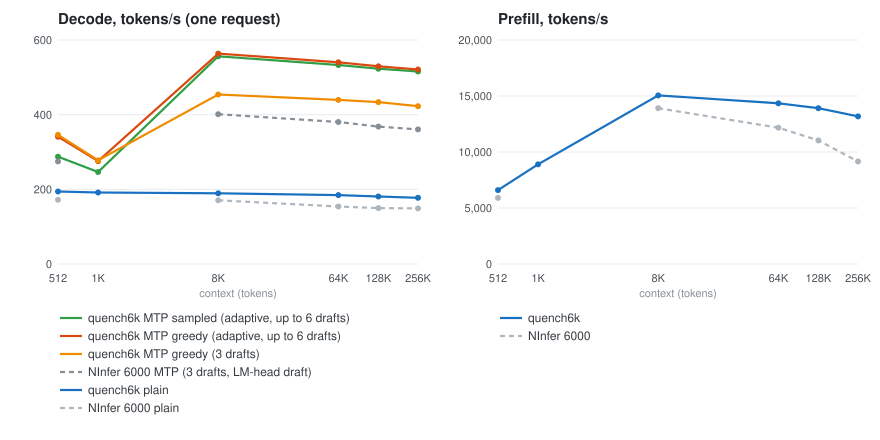
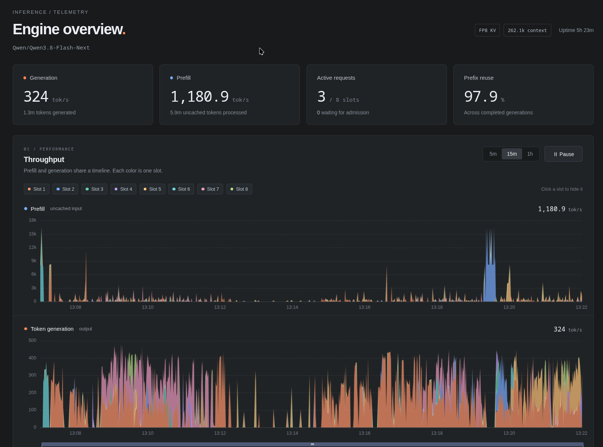

# quench6k

A Rust/CUDA inference engine optimized for Qwen3.8 Flash-Next 125B-A6B in NVFP4 on a single NVIDIA
RTX PRO 6000 Blackwell (96 GB). Rust host code, hand-written CUDA kernels for `sm_120a`, weights loaded
directly from the safetensors checkpoint ([supported checkpoints](DOCS.md#checkpoints)). Also supports
[Recursive Flint](#recursive-flint) 40B-A2.5B from its NVFP4 GGUF.

[](BENCHMARK.md)

## Features

- OpenAI-compatible chat and text completions, and Anthropic Messages: streaming, reasoning and
  tool calls validated against their schemas and regenerated when malformed.
- Up to eight concurrent Qwen requests, with batched decoding, interleaved text prefill and
  memory-aware admission. Flint serves one request at a time.
- Adaptive MTP speculative decoding for greedy and sampled Qwen requests; optional DFlash 2 drafter.
- Context up to 262,144 tokens per request; BF16 or FP8 KV cache.
- Images and video for Qwen, with image content included in prefix-cache identity.
- Context cache: snapshots on the GPU, a pinned host tier and a disk tier that survives restarts.
- Rank-1 adapters served alongside the base model under a separate model name, sharing its weights.
- Direction-removal steering packs with a per-request strength; activation capture.
- [Built-in web dashboard](#dashboard), JSON statistics and per-slot Prometheus metrics.

## Dashboard

Open [http://localhost:8003/](http://localhost:8003/) after starting the server. Prefill and token
generation are stacked by slot on vertically aligned plots, with linked cursors, pan, zoom and a
shared range slider. Request activity, queue depth, prefix reuse and per-slot KV memory help show
where the engine is busy.



The server records one-second live samples and retains 31 days of minute history on disk using
embedded [tsink](https://github.com/aidlx/tsink). History and cumulative request/input/output token
totals survive restarts. Choose 5m through 31d ranges; long views show average throughput and peak
concurrency. Usage totals cover the visible range and all recorded time. Idle slots are omitted from
hover highlights, and chart series adapt to the configured slot count. Alpine.js and ECharts are vendored into the binary, with no CDN or frontend
build step.
Raw data is available at `/stats` and `/metrics` ([API details](DOCS.md#http-api)).

## Install

Daily builds of `main` are on the [releases page](https://github.com/lkarlslund/quench6k/releases),
tagged `rNNNN` (the number of commits on `main`): Linux x86_64, Linux arm64 and Windows x86_64. They
need an NVIDIA driver that supports CUDA 13.4. Only Linux x86_64 is tested on hardware.

From source (Rust stable, CUDA toolkit 13.x with `sm_120a` support):

```
cargo build --release
```

## Run

```
quench6k serve --model /path/to/Qwen3.8-Flash-Next-NVFP4 --listen 0.0.0.0:8003 \
    --context 262144 --slots 8 --kv fp8 --cache-dir ~/.cache/quench6k
```

Loading takes about 30 s (72.7 GiB uploaded to the GPU). Keep the checkpoint on fast local storage:
prefill reads per-layer embedding rows from it on demand.

Slots share the available GPU memory: eight slots do not reserve eight full-size contexts. Requests
wait when their memory plans cannot fit, and idle contexts move to the host/disk cache as needed.

```
curl http://localhost:8003/v1/chat/completions -H 'content-type: application/json' \
    -d '{"messages": [{"role": "user", "content": "Hello"}]}'
```

## Recursive Flint

quench6k also runs [Recursive Flint](https://huggingface.co/RecursiveSI/flint) (40B-A2.5B MoE) from
the vendor's [NVFP4 GGUF](https://huggingface.co/RecursiveSI/flint-nvfp4-gguf). Point `--model` at a
directory holding `flint-nvfp4.gguf` together with `tokenizer.json`, `chat_template.jinja`,
`config.json` and `generation_config.json` from the BF16 repository:

```
quench6k serve --model /path/to/flint-nvfp4-gguf --listen 0.0.0.0:8013 --context 262144 --kv fp8
```

The server serves one request at a time, reuses the prompt prefix across requests, and handles the
model's own `<think>` reasoning and its tool-call format. Flint has no MTP head; the server speculates
with prompt-lookup drafts instead (the tokens that followed the latest earlier occurrence of the last
3 or 4 tokens, up to 7 as the request's acceptance rate allows, verified in one step). On a 26K-token
coding-agent edit request (sampled, temperature 1) that takes decoding from 382 to 738 tok/s (3.8
tokens per step); on free-form text it costs under 1%. Verification steps run
batched kernels, so speculative greedy output is not bit-identical to plain greedy output (it differs
by rounding); `"mtp": false` in a request turns it off. Throughput on the same machine at 600 W, with
greedy decoding of 128 tokens and FP8 KV from 64K up (BF16 KV below that):

| Context | Prefill (tok/s) | | Decode (tok/s) | |
|---:|---:|---:|---:|---:|
| | quench6k | llama.cpp | quench6k | llama.cpp |
| 512 | 7,936 | 5,691 | 497 | 252 |
| 8,192 | 24,245 | 11,515 | 449 | 228 |
| 65,536 | 15,121 | 7,991 | 356 | 188 |
| 131,072 | 10,530 | 5,591 | 290 | 151 |
| 260,000 | 6,454 | 3,462 | 212 | 110 |

llama.cpp at c7fc50941 (`llama-bench -fa 1 -ub 2048`, F16 KV). Prefill is the BF16 KV run (FP8 is
0–15% slower there). Records: `bench/flint.jsonl`, `bench/flint-llamacpp.jsonl`.

## Documentation

- [DOCS.md](DOCS.md): commands, server options, API, sampling, caching, steering.
- [BENCHMARK.md](BENCHMARK.md): throughput and how it is measured.
- [DEVELOPMENT.md](DEVELOPMENT.md): building, testing, the correctness gate, project history.

No license has been chosen yet; all rights reserved.
